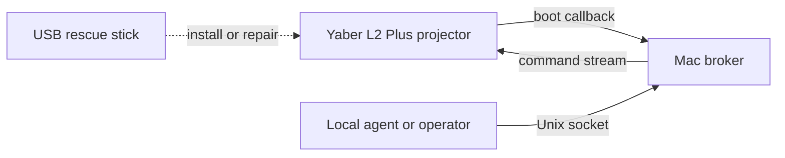

# Yaber L2 Plus owner access toolkit

A reproducible, owner-operated workflow for maintaining a local shell connection to a Yaber L2 Plus projector on your own network.

This repository is sanitized for public use. It does not include private photos, packet captures, serial numbers, local IP addresses, email addresses, or machine-specific paths.

## What this does

- Runs a local Mac broker that receives the projector callback.
- Builds a configured FAT32 USB payload for the projector owner.
- Uses the USB boot/debug hook to install a persistent projector callback agent and launcher hook.
- Provides a local command tool so agents or scripts can run commands after the projector connects back.
- Keeps the same USB as a rescue path so the owner can repair or reinstall the callback agent.

## Scope

Use this only on hardware you own or administer. The workflow assumes physical access to the projector, local network access, and the ability to prepare a USB drive. It is intended for owner repair, automation, accessibility, and research on owner-operated devices.

## Current architecture



## Quick start overview

1. Find your Mac LAN IP address.
2. Start the Mac broker with `scripts/projector_broker.py`, or install it as a LaunchAgent.
3. Build a configured USB payload:

   ```sh
   python3 tools/configure_payload.py YOUR_MAC_LAN_IP --broker-port 2325
   ```

4. Copy the files from `build/usb-root/` to the root of a FAT32 USB drive.
5. Boot the projector with the prepared USB stick inserted.
6. Wait for the projector to connect back to the broker.
7. Verify with:

   ```sh
   python3 scripts/projectorctl.py status
   python3 scripts/projectorctl.py cmd 'whoami; pwd; date' --timeout 10
   ```

8. Remove the USB and cold reboot once to verify no-USB persistence.

Read the docs in this order:

- [docs/ARCHITECTURE.md](docs/ARCHITECTURE.md)
- [docs/MAC_BROKER.md](docs/MAC_BROKER.md)
- [docs/USB_RECOVERY.md](docs/USB_RECOVERY.md)
- [docs/VALIDATION.md](docs/VALIDATION.md)
- [docs/TROUBLESHOOTING.md](docs/TROUBLESHOOTING.md)
- [docs/SECURITY_AND_SCOPE.md](docs/SECURITY_AND_SCOPE.md)

## Known limitations

- The projector must be on the same LAN as the Mac broker.
- The default setup is LAN-local; it is not designed for internet exposure.
- If the Mac IP changes, rebuild the USB payload and update the projector agent configuration or use a DHCP reservation.
- The USB recovery path depends on firmware behavior observed on an L2 Plus firmware branch. Other firmware versions may differ.

## Validate

```sh
./tools/validate.sh
```

## License

MIT. See [LICENSE](LICENSE).
